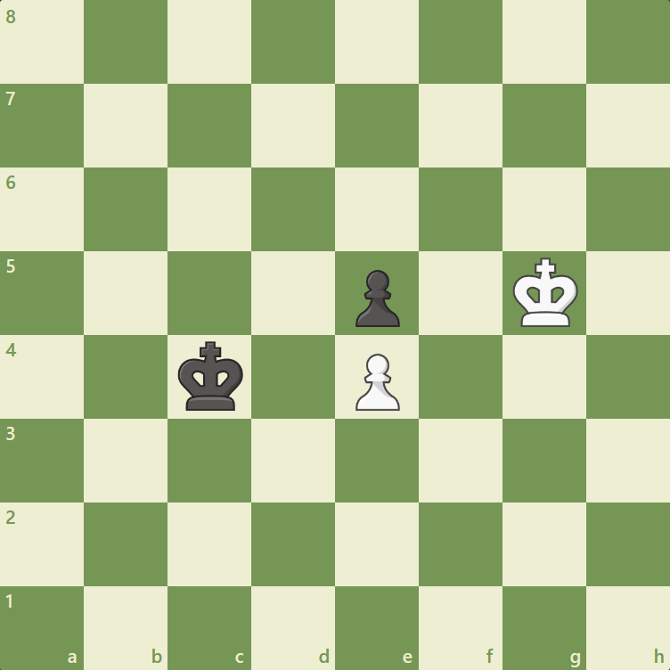

# chessimg2pos — Chess Image to FEN in Python

[](https://pypi.org/project/chessimg2pos/)
[](https://pypi.org/project/chessimg2pos/)
[](https://pepy.tech/project/chessimg2pos)
[](https://github.com/mdicio/chessimg2pos/blob/master/LICENCE)
[](https://github.com/mdicio/chessimg2pos)

**Convert a chessboard image, screenshot or photo into a FEN string with one line of Python.**

`chessimg2pos` recognises chess positions. Give it a chess.com or lichess screenshot, a puzzle or book diagram, a whole screen with a board somewhere in it, or a phone photo of a screen or printed page. It returns the position as [FEN](https://en.wikipedia.org/wiki/Forsyth%E2%80%93Edwards_Notation), ready for Lichess, Stockfish or `python-chess`. The model downloads automatically on first use and runs on the CPU with ONNX Runtime, so PyTorch is not needed.

```bash
pip install chessimg2pos
```

```python
from chessimg2pos import predict_fen
print(predict_fen("screenshot.png"))   # 8/8/8/4p1K1/2k1P3/8/8/8
```

```bash
chessimg2pos screenshot.png            # same, from the command line
```

**Use cases:** analyse a position from a screenshot, digitise chess book diagrams, build chess bots and Discord/Telegram bots, or turn puzzle collections into FEN/PGN datasets.

### Features

- 🖼️ **Image → FEN** in one call, for whole screenshots too: the board is found for you
- 📱 **Phone photos**: the four board corners are located and the board is straightened
- 🔄 **Orientation**: detects when Black is at the bottom and still returns standard FEN
- ♟️ **Legality step**: fixes impossible results (two white kings, pawns on the back rank), but only on squares the model was unsure about
- 🎯 **Confidence** per board and the board's location in the image
- ⚡ About 90 ms per image on a CPU; no PyTorch needed for inference
- 🌐 **Browser demo** that runs fully client-side

---

## 🎯 Accuracy

Exact-board accuracy is the share of images where all 64 squares are right. The positions in every suite were held out of training.

| suite | images | **chessimg2pos** | [tsoj/Chess_diagram_to_FEN](https://github.com/tsoj/Chess_diagram_to_FEN) | fenshot | chessimg2pos 0.1.x |
|---|---:|---:|---:|---:|---:|
| lichess renders, all themes and piece sets | 1000 | **100.0** | 95.4 | 94.0 | 43.5 |
| chess.com renders | 301 | **100.0** | 100.0 | 100.0 | – |
| mixed styles (highlights, arrows, coordinates, JPEG) | 1000 | **99.0** | 86.2 | 61.9 | – |
| board inside a screenshot | 500 | **98.8** | 86.8 | 76.6 | – |
| book diagrams | 300 | **97.7** | 86.7 | 37.0 | – |
| hand-collected legacy boards | 100 | **100.0** | 97.0 | 47.0 | – |
| phone photo of a screen or printed diagram | 400 | **98.0** | 55.0 | 2.0 | – |

How the suites were made, so you can judge the numbers:

- The lichess, mixed-style, screenshot, book and photo suites are rendered by our own data pipeline. The model was trained on the same pipeline, using different positions. Other tools never saw these exact styles.
- The photo suite is simulated: perspective, lighting, moiré, blur and noise over flat 2D boards. Photos of physical 3D sets are not supported yet.
- A board counts as correct if it matches the truth from either side. The model also detects when Black is at the bottom: 86–100% of the time, depending on the suite (book diagrams are hardest).
- Speed: about 30 ms per image on a GPU (PyTorch) and about 90 ms on a CPU (ONNX Runtime).
- "chessimg2pos 0.1.x" is the old tile-by-tile model, replaced in 0.2.0.

---

## 🧪 Usage

### Python

```python
from chessimg2pos import predict_fen

predict_fen("screenshot.png")                       # '8/8/8/4p1K1/2k1P3/8/8/8'
predict_fen("screenshot.png", fen_type="expanded")  # '11111111/11111111/11111111/1111p1K1/...'

r = predict_fen("photo.jpg", output_type="full")
r["fen"]                     # 1Bk5/8/8/P4K2/3R4/n1P3r1/8/3Q4  (from White's view)
r["orientation"]             # "black": Black is at the bottom of the image
r["fen_as_drawn"]            # the placement as it appears in the image
r["confidence"]              # probability of the least certain square
r["board_corners"]           # where the board was found (TL, TR, BR, BL in pixels)
r["legality_changes"]        # squares changed by the legality step
```

`predict_fen` accepts a file path or a PIL image. Phone photos are turned upright from their EXIF orientation. The model loads once and is reused, so later calls are fast.

The image gives only the piece placement. Side to move, castling rights and en passant are not in the picture, so add them yourself if needed:

```python
import chess
from chessimg2pos import predict_fen

fen = predict_fen("screenshot.png")
print(f"https://lichess.org/analysis/{fen}")
board = chess.Board(fen + " w - - 0 1")
```

For many images, or to control the weights, use a predictor directly:

```python
from chessimg2pos import load_predictor

pred = load_predictor()                              # release weights, downloaded once
results = pred.predict_batch(["a.png", "b.png", "c.png"])
```

`load_predictor()` downloads the release weights (about 170 MB, once) to `~/.cache/chessimg2pos/`, or uses `$CHESSIMG2POS_V2_WEIGHTS` if set. `load_predictor("dir/")` uses a folder containing `board.onnx` and `locator.onnx`. `load_predictor("model.pt")` uses a training checkpoint with PyTorch (`pip install "chessimg2pos[torch]"`). `predict_fen(..., weights=...)` takes the same values.

### Command line

```bash
chessimg2pos screenshot.png                # prints the FEN
chessimg2pos *.png --lichess               # FEN + lichess analysis link per file
chessimg2pos photo.jpg --json              # orientation, confidence, board corners, ...
chessimg2pos --help
```

### In the browser

`web/index.html` runs the same ONNX models with onnxruntime-web, entirely on the client, so no image is uploaded. Put `board.onnx` and `locator.onnx` in `web/models/` and serve the folder (`python -m http.server`). Then drop, paste or pick an image.

---

## 🖼️ Sample result

<div align="center">

#### 📷 Input:


#### 🎯 Predicted FEN:
`8/8/8/4p1K1/2k1P3/8/8/8`

</div>

---

## 🧠 How it works

1. **Locator** (ResNet-18): finds the board's four corners in the image, in two passes (rough on the whole image, then refined on a crop).
2. **Board reader** (ConvNeXt-tiny + transformer): the board is cropped, or perspective-corrected for photos, to 256×256. The backbone's 8×8 feature map puts one cell on each square. A transformer then lets every square see the whole board (piece set, colours, which side is at the bottom) before classifying it into 13 classes, and predicts the orientation.
3. **Legality step**: at most one king per side, no pawns on the back ranks, at most 8 pawns and 16 pieces per side. Squares predicted with probability ≥ 0.97 are never changed, so unusual but genuine diagrams survive. A missing king is never invented.

## 🔧 Training

```bash
pip install "chessimg2pos[torch]"
```

`tools/train_v2.py` trains the board reader and the locator together from any sample stream: a folder with `manifest.jsonl` or your own Python sampler (see `chessimg2pos/v2/data.py` for the format). `tools/export_onnx.py` exports a checkpoint to ONNX and checks the output against PyTorch. `tools/benchmark/` holds the harness that produced the table above.

## 🔁 Upgrading from 0.1.x

0.2.0 replaces the tile-by-tile model with the one above.

- `predict_fen` keeps its signature and now returns standard FEN (`8/8/...`). For the old one-character-per-square format pass `fen_type="expanded"`. The old value `fen_type="standard"` still works with a deprecation warning.
- `ChessPositionPredictor` and `ChessRecognitionTrainer` were removed. Use `load_predictor` and `tools/train_v2.py`. To keep the old classes, pin `chessimg2pos==0.1.6`.
- PyTorch is no longer installed by default. Add the `[torch]` extra for training or `.pt` checkpoints.

## 🙏 Acknowledgements

The first versions of this project built on:

- [linrock/chessboard-recognizer](https://github.com/linrock/chessboard-recognizer), the original TensorFlow implementation and its chess image data
- [tensorflow_chessbot](https://github.com/Elucidation/tensorflow_chessbot) by [Elucidation](https://github.com/Elucidation)

Major thanks to these creators — this project wouldn’t exist without their work.
